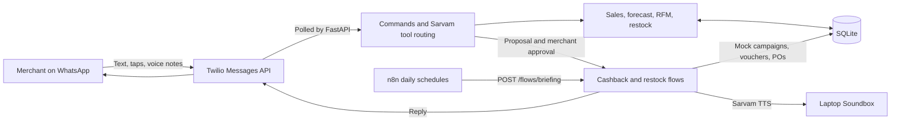

# Vyapar Copilot

**A WhatsApp assistant that helps small merchants understand sales, bring regular customers back, and restock before shelves run empty.**

Built for **Paytm Build for India AI Hackathon · Track 1: Merchant Growth AI** by **Team Xyz**.

Vyapar Copilot turns payment history and POS data into recommendations that a shop owner can review in WhatsApp. Merchants can tap a button, type in English or Hinglish, or send a voice note. Cashback campaigns and purchase orders require merchant approval.

> **Hackathon prototype:** merchant messaging and Sarvam AI calls are live integrations. Sales and inventory are synthetic; Paytm campaign creation, customer voucher delivery, distributor delivery, and campaign results are simulated. The Soundbox is represented by audio on the laptop speaker.

## What it does

| Feature | Merchant | Behavior |
| --- | --- | --- |
| **Morning Briefing** | Kirana store | Compares yesterday's sales with the same weekday last week, predicts upcoming slow hours, and proposes cashback when the model estimates a positive return. Sends a WhatsApp summary and queues a spoken announcement. |
| **Slump Buster** | Kirana store | Finds a slow window, identifies at-risk regulars, and prepares an offer. The merchant can approve, reject, or change the percentage and duration. Approval creates a mock campaign and voucher records; `result` reports simulated redemptions. |
| **Smart Restock** | Electronics / POS store | Estimates time to stockout from SKU sales, stock, and supplier lead times. Drafts purchase orders grouped by distributor and records them after approval. Its morning briefing opens with the restock check. |

### Built around the available data

The kirana demo uses payment **timestamp, amount, and hashed payer identity**, plus a merchant-declared average margin. It does not infer products or item margins from QR payments. Smart Restock uses a separate POS persona because it needs SKU-level stock and sales.

Both demo stores share the phone configured in `.env`:

| Store | Merchant ID | Data |
| --- | --- | --- |
| Gupta Kirana Store | `gupta-kirana` | 180 days of synthetic QR payment history |
| Sharma Electronics, Phoenix Mall | `sharma-electronics` | 40 SKUs and 90 days of synthetic unit sales |

## How it works



One FastAPI process hosts the analytics endpoints, conversation flows, and background Twilio poller. Incoming messages are polled every three seconds by default, so the local demo needs no webhook or public tunnel. n8n only triggers the daily briefings; FastAPI handles the messages.

| Layer | Implementation |
| --- | --- |
| Backend | Python 3.12+, FastAPI, Uvicorn, HTTPX |
| Analytics | pandas, NumPy, scikit-learn `HistGradientBoostingRegressor` |
| Conversation and tool selection | Sarvam; configured default: `sarvam-105b-conversations` |
| Voice-note transcription | Sarvam; configured default: `saaras:v3`, `codemix` mode |
| Spoken announcements | Sarvam; configured default: `bulbul:v3` |
| Merchant messaging | Twilio WhatsApp text, quick-reply buttons, and list pickers |
| Persistence | SQLite: proposals, campaigns, outbox, sessions, and message history |
| Scheduling | Local n8n workflow |

### Numbers and approval rules

- **Business figures come from Python analytics and fixed templates.** The LLM selects tools and can write a short opener. Generated prose containing digits or unknown placeholders is rejected.
- **Cashback is bounded by the shop's margin.** Candidates range from 5% to `min(15%, margin / 2)`. The seeded kirana has a 20% margin, so its cap is 10%. The optimiser skips campaigns with no positive estimated incremental profit.
- **Changes are checked again.** Modified offers must pass the cap, duration bounds of 30 minutes to eight hours, and estimated-profit checks. Live campaigns cannot be edited midway.
- **Approvals persist in SQLite.** Proposals can be executed, rejected, expired, or superseded. Restock drafts currently support approval or rejection as-is.

The cashback response curve is an assumption for the demo, not a measured conversion model or a guarantee of profit. The forecast's `holdout_mape` measures daily payment totals over the final 14 days of synthetic history.

## Run locally

### Requirements

- Python **3.12 or later** and [uv](https://docs.astral.sh/uv/getting-started/installation/).
- A Sarvam API key for chat, transcription, and speech generation.
- A Twilio account with a WhatsApp sender and a recipient configured for that sender or joined to its sandbox.
- Node.js and npm for the optional n8n scheduler.
- macOS for the current Soundbox playback implementation, which calls `afplay`. Other platforms need an audio-player adaptation; WhatsApp flows do not depend on successful speaker playback.

Run these commands from the repository root:

```bash
uv sync --locked
cp .env.example .env
```

Fill in `.env` before seeding or starting the app:

| Variable | Purpose / default |
| --- | --- |
| `SARVAM_API_KEY` | Required for Sarvam API calls |
| `TWILIO_ACCOUNT_SID` | Twilio account SID |
| `TWILIO_AUTH_TOKEN` | Twilio authentication token |
| `TWILIO_WHATSAPP_FROM` | Business sender, using the `whatsapp:+<country-code><number>` format |
| `DEMO_MERCHANT_WHATSAPP` | Your test recipient, in the same format; assigned to both demo stores |
| `TWILIO_POLL_SECONDS` | Incoming-message polling interval; default `3` |
| `DATABASE_PATH` | SQLite path; default `var/vyapar.db` |
| `DEMO_NOW` | Fixed application clock; the example uses `2026-10-06T13:45:00+05:30` |
| `TIMEZONE` | Application timezone; default `Asia/Kolkata` |
| `SARVAM_CHAT_MODEL`, `SARVAM_STT_MODEL`, `SARVAM_STT_MODE`, `SARVAM_TTS_MODEL` | Model overrides; see `.env.example` |

Keep `.env` local; it is ignored by Git. `APP_PORT` appears in the example file, but Uvicorn's `--port` flag controls the server port.

```bash
# Generate or reset the demo database.
uv run python -m scripts.seed

# Start the API and incoming WhatsApp poller.
uv run uvicorn app.main:app --host 127.0.0.1 --port 8000
```

Seeding clears the demo's merchant, transaction, proposal, campaign, outbox, session, and chat records. Stop the server before resetting. An empty merchant database is also seeded automatically at startup.

The fixed demo clock keeps the afternoon offer and festive restock scenario repeatable. Leave `DEMO_NOW` empty to use the real clock, then reseed. **The fixed clock does not advance:** use `result` to close a campaign during a rehearsal. Twilio polling and n8n schedules use real time.

Check the running app at [the health endpoint](http://127.0.0.1:8000/health) and inspect its API at [Swagger UI](http://127.0.0.1:8000/docs).

**Before each WhatsApp demo, send `hi` from the recipient phone to the business sender.** Free-form replies require an open 24-hour customer service window; scheduled messages outside that window need approved templates that this demo does not implement. See [Twilio's WhatsApp concepts](https://www.twilio.com/docs/whatsapp/key-concepts).

### Optional: schedule the morning briefings

Keep FastAPI running, then use a second terminal at the repository root:

```bash
export N8N_USER_FOLDER="$PWD/var/n8n"
export GENERIC_TIMEZONE=Asia/Kolkata

# Import and publish once, before starting the scheduler.
npx n8n import:workflow --input=n8n/morning-briefing.json
npx n8n publish:workflow --id=vyaparBriefing0830
npx n8n start
```

The workflow schedules **Gupta Kirana at 08:30 IST** and **Sharma Electronics at 08:35 IST** daily. Its manual trigger runs only the kirana briefing. n8n must remain running for scheduled executions. After publishing through the CLI while n8n is already running, restart it for the change to take effect; see the [n8n Server CLI documentation](https://docs.n8n.io/hosting/cli-commands/).

To trigger the kirana briefing immediately from another terminal with the same n8n environment:

```bash
npx n8n execute --id=vyaparBriefing0830
```

The workflow calls `127.0.0.1:8000`. If you change Uvicorn's port or move n8n to another host, update the workflow URLs too.

## Try the demo

The bot offers tappable choices and falls back to numbered text if interactive sending fails. Typed numbers answer the latest prompt; `menu` brings back the store menu. Explicit commands are useful when rehearsing.

| Step | Send in WhatsApp | Expected behavior |
| --- | --- | --- |
| 1 | `hi` | Open the session and show the kirana menu. |
| 2 | `briefing` | Show yesterday's sales, a predicted slow window, and a cashback proposal; queue the Soundbox summary. |
| 3 | Type or voice-note `8% kar do, sirf 2 ghante` | Interpret the change, recheck the offer, and ask for approval. |
| 4 | `approve` | Create the mock campaign, record customer vouchers, and send the merchant a sample customer view. |
| 5 | `40% chaiye` | Reject a change above the safe cap; keep the existing campaign. |
| 6 | `result` | Close the campaign with simulated redemptions and report sales, cashback, and estimated net profit. |
| 7 | `switch electronics` | Switch the shared demo phone to the POS store. |
| 8 | `stock`, then `approve` | Draft purchase orders, record them by distributor, and show a sample distributor view. |
| 9 | `switch kirana` | Return to the kirana store. |

Other commands include `sales`, `slump`, `reject`, and `menu`. Free-form business questions use Sarvam tool selection. Outgoing messages are text and interactive choices; audio replies play on the laptop rather than arriving as WhatsApp voice messages.

### Rehearse in the terminal

```bash
uv run python -m scripts.simulate

# Or send your own sequence of messages.
uv run python -m scripts.simulate "briefing" "8% kar do" "approve" "result"
```

The simulator uses a separate `var/simulate.db`, reseeds it each run, and prints WhatsApp and Soundbox output. **It still calls Sarvam** for model-dependent steps, so configure a valid Sarvam key. It does not send Twilio messages or play audio.

## API reference

| Method | Endpoint | Purpose |
| --- | --- | --- |
| `GET` | `/health` | App health and the current application clock |
| `GET` | `/analytics/forecast` | Hourly payment forecast and holdout daily MAPE |
| `GET` | `/analytics/predict-slump` | Upcoming slow window, proposed offer, and safe cap |
| `GET` | `/analytics/customer-segments` | RFM segment counts and average tickets |
| `GET` | `/analytics/restock` | At-risk SKU lines, reorder value, and cash-gap flag |
| `POST` | `/flows/briefing` | Generate and send a merchant briefing |

Analytics endpoints accept a `merchant_id` query parameter. Forecast, slump, and segmentation default to `gupta-kirana`; restock defaults to `sharma-electronics`. Use the kirana persona for payment analytics and the electronics persona for SKU analytics.

```bash
curl http://127.0.0.1:8000/analytics/predict-slump
curl 'http://127.0.0.1:8000/analytics/restock?merchant_id=sharma-electronics'

# Sends a real merchant message when Twilio is configured.
curl -X POST 'http://127.0.0.1:8000/flows/briefing?merchant_id=gupta-kirana'
```

Calling `/flows/briefing` without a merchant ID briefs both stores. The API has no authentication and is intended for this local demo; keep it bound to loopback.

## Tests

```bash
uv run pytest -q
```

The tests run without live Sarvam or Twilio calls. They cover numeric-output guards, Indian currency formatting, cashback caps and modifications, restock calculations, slump detection, language and address handling, interactive-choice constraints, and prompt state.

## Repository map

```text
app/
  main.py               FastAPI endpoints and poller lifecycle
  config.py             Environment settings and demo clock
  db.py                 SQLite schema and helpers
  agent/                Command routing, tool selection, language, number guards
  analytics/            Forecasts, RFM, cashback, restock, synthetic data
  channels/             Twilio REST client and background polling
  flows/                Briefing, campaign, restock, and approval flows
  sarvam.py             Chat, STT, and TTS clients
  mock_paytm.py         Mock campaign IDs, voucher codes, and UPI links
  soundbox.py           Queued laptop audio playback
n8n/                    Daily briefing workflow
scripts/                Seed, terminal simulation, integration probes
tests/                  Offline rule and prompt-state tests
docs/                   Original build scope and technology notes
DECISIONS.md            Implementation decision log
```

The root also includes the original hackathon brief, project proposal, and pitch deck. [Build scope](docs/SCOPE.md), [tech stack](docs/TECH_STACK.md), and [decisions](DECISIONS.md) capture the original planning context; this README describes the current implementation.

## Demo boundaries

- Paytm payments and POS ingestion are synthetic fixtures. There is no live Paytm integration or inventory feed.
- Customer vouchers and distributor purchase orders are stored in SQLite's `outbox`. Only the merchant receives real WhatsApp messages, including sample customer and distributor views. Messages saying vouchers or POs were “sent” represent the simulated delivery step.
- `result` draws redemptions from the assumed cashback response curve and ends the campaign immediately. It does not observe payments, settle cashback, or prove customer win-back.
- The two-store switch is a demo convenience. Production authentication, merchant onboarding, and tenant isolation are not implemented.
- The forecast and festival assumptions are tuned to the seeded scenario. They need validation against real merchant data before operational use.

## Team

**Team Xyz** · Paytm Build for India AI Hackathon

- **Mahesh Shekokar** — Full-stack AI
- **T N Sreevarsan** — Data Science
